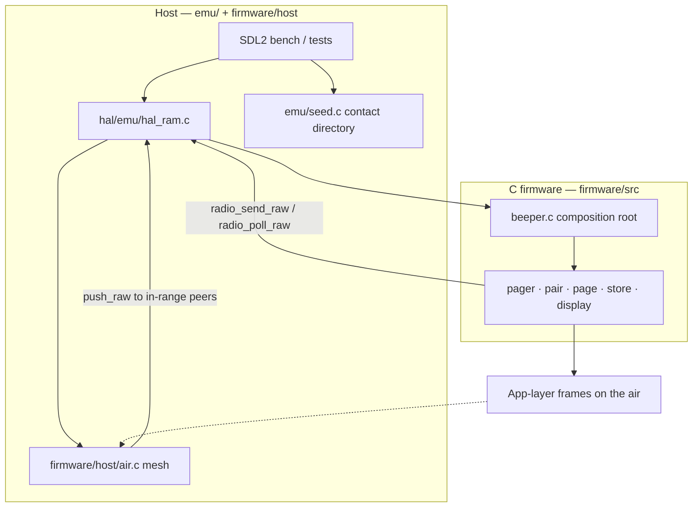

# Architecture

Peeple Beeper firmware is C under `firmware/`. It talks only to a HAL (`hal/hal.h`). Implementations live under `hal/`, one directory per machine: `hal/emu` for tests and the desktop emulator, `hal/beeper` for the beeper board. `firmware/host/` is the desktop foot-grid mesh, not a HAL.

There is no second pager in TypeScript. Host code is an SDL2 window, `hal/emu`, and the foot-grid mesh.

---

## Layer cake

The host never implements pairing or PAGE crypto. Firmware never knows about SDL, NVM files, or where the radios sit. They meet only at the HAL.



Tick order, frame types, and crypto are in [firmware-app.md](firmware-app.md) and [radio-protocol.md](radio-protocol.md).

---

## Directory map

| Path | Role |
|------|------|
| `hal/hal.h` | HAL contract (`hal_t` ops + `ctx`). Shared. Not an implementation. |
| `hal/emu/` | RAM HAL for tests and the desktop emulator. |
| `hal/beeper/` | Beeper board HAL. Today this is the nRF52840 stub (`make nrf-check`). |
| `firmware/include/beeper.h` | `beeper_init` / `tick` / `reset` / `debug_key`. |
| `firmware/src/*.c` | Pager, pair, page, store, display, crypto, frames. |
| `firmware/host/` | Desktop radio mesh (`air.c`) only. Tests and the emulator. |
| `firmware/art/` | Generated 1-bit picture bytes (`art.c`). |
| `firmware/tests/` | `page_test`, `store_test`, `mesh_test`, `locate_test`. |
| `emu/` | SDL2 window + `seed.c` host directory. |
| `Makefile` | `make test`, `make emu`, `make nrf-check`. |
| `docs/` | This map and protocol/app/HAL notes. |
| `tools/png_to_art.py` | Any PNG to a 1-bit C array. |
| `tools/beeple_to_art.py` | Mascot PNGs into `firmware/art`. |

A new `.c` file goes in the directory of its kind. Product logic stays in `firmware/src`. The desktop mesh stays in `firmware/host`. Generated picture bytes stay in `firmware/art`.

Every HAL implementation lives under `hal/`, in a directory named for the machine it drives. `hal/emu` is the emulator. `hal/beeper` is the beeper. A new machine gets `hal/<machine>/` and implements `hal/hal.h`. It does not go in `firmware/src` or `firmware/host`.

`firmware/host/air.c` is the desktop range model: feet and RSSI. The packet path is `frames.c` (byte layout), `crypto.c` (SHA-256 constructions), and `relay.c` (the forward cache). Frame layout, seals, and hop policy do not go in `air.c`.

---

## One decision, one file

A change lands in the file that already owns that decision. When two files would both have to change, the decision has no owner: put it in one place and have the other call it. Two files stay apart when they change for different reasons.

`pager.c` is the screen. `page.c` is the message session. A new file does not take a name one letter away from either. `pair.c`, `page.c`, and `locate.c` are peer sessions on one radio. `beeper.c` is the only place that chooses which session runs on a tick. A new frame kind is dispatched there. `page.c` handles page and page-ack. It does not drain another session's frames, and it does not tick another session. Today `page_tick` still receives locate frames and then calls `locate_tick`. That pump is the shape to finish, and new sessions do not grow under it.

| Decision | Owner | What stays outside |
|----------|--------|-------------------|
| Wire layout of every frame | `frames.c` | Sessions call encode and decode. |
| SHA-256 session key, seal, ack tag, locate tag | `crypto.c` | Sessions pass bytes in. |
| Attempt loop for a sealed send: nonce list, attempt count, next-send time, accept a reply only from that peer on a stored nonce while the send is in flight | One helper. A page is nine tries, ten seconds then a minute. A locate is four tries, two seconds apart. Today each session still has its own copy. | Text, mascot, fix, denial, and no-sky stay in the session that owns them. `page.c` and `locate.c` stay two files. |
| Forward cache: remember a frame, wait 80–400 ms, decrement the hop, send once, cancel a request when its reply is already stored | `relay.c`. `page.c` and `locate.c` each still decide which frames enter a cache. | Sessions hand it a frame. A new entry rule is written once, in `relay.c`. |
| Eight-way cut of a north/east offset, boundary at the tangent of 22.5° | One function. `gps.c` still has a second copy of the cut. | Hold flat, hold still, the 400 ms wait, and the arrow in the device frame stay in `heading.c`. |
| Empty display name shown as the last four hex digits of the id | `identity.c`. `contacts.c` still has its own copy for a blank paired name. | A contact book calls the identity rule. |
| Receiver schedule and the stored fix: listen up to a minute about every half hour, keep one fix | Its own unit, called from `beeper_tick`. | The locate nonce list and the Allow/Deny queue stay on the locate session. Locate reads the stored fix when it answers. |
| RMC sentence | `nmea.c`, the only parser | The board HAL pushes UART bytes into it. The RAM HAL stores a fix the bench already built. |
| Foot grid, arcminutes, distance | `gps.c` | |
| Mascot index, menu label, and bitmap | Generated next to `firmware/art/art.c`. The screen indexes the catalog. | `png_to_art.py` packs any PNG. `beeple_to_art.py` writes the bytes and the catalog. Today `--write` still splices the `BEEPLES` table in `pager.c`. Arrows and side decorations are sprites in `art.c`. They are separate from mascot indexes. |

`display.c`, `textedit.c`, `canned.c`, `store.c`, and `emu/font.c` are already one concept each. The bench font is the SDL atlas for the window chrome. The panel font is the 5×7 and 3×6 bitmaps in `display.c`. Leave them apart. Folding `frames.c` or `crypto.c` into a session would put the wire format in whichever session was nearest.

---

## One beeper, many radios

`beeper_init()` is the composition root of **one** unit. RAM lives on that object, not in module globals.

```text
beeper_t
  identity     node_id + display name
  contacts     session keys for peers
  pager        screens, inbox, outbox, canned, editor
  pair         whisper pairing session
  radio        PAGE TX/RX/relay
  locate       position exchange
  nvm_ready / nvm_hash
```

The saved fix and the listen schedule still sit on `locate` today. New schedule fields go with the receiver unit in the table above, not onto the nonce list.

The emulator wraps each unit with a `ram_hal_t`, a name (`A`, `B`, …), and an east/north foot position. The bench starts with three radios at east 0 / 75 / 150, north 0. **+ add** / **− remove** in the top bar grow the bench up to 16; the window widens to keep every LCD on screen. The compass under each LCD moves that unit; the mesh uses the straight-line distance and relinks immediately. Each device is ticked independently (`beeper_tick`).

---

## Desktop mesh

Radios sit on the east/north foot grid. A hop exists only if the straight-line distance is under 100 ft (`RADIO_RANGE_FT`). RSSI is about −30 dBm at 0 ft and falls ~60 dB across that span; at 100 ft the link is silent (no `push_raw`). There is **no collision model**. Firmware paging does not gate on RSSI; pairing still requires ≥ −45 dBm.

The host also seeds contact books (`emu/seed.c`) so every unit can Compose to every other without walking HELLO. That seeding is host-only. It is not a frame kind.

---

## Persistence

| What | Where |
|------|--------|
| Device NVM | HAL `nvm_load` / `nvm_save`. Emulator files in the per-user app support directory (`emu-nvm-<id>.bin`). Tests: RAM blob. |
| Firmware RAM | Each `beeper_t` | Not persisted except via NVM |

`store.c` is the firmware codec (`PB01` v2). The HAL does not parse the blob.

---

## Run and test

```
make test
make emu
./build/peeple-emu
```

A test file is named for the decision it pins. A new proof of a decision goes in that file. The same proof does not get a second copy in a test named for the feature that happened to call it.

| Before changing | Run |
|-----------------|-----|
| Page session, ack, frames, page crypto | `page_test` |
| Forward cache: jitter, hop drop, already-sent | `page_test` and `locate_test`, until that proof has one file |
| Locate session, Allow/Deny, tracking warning | `locate_test` |
| Foot grid, RMC, eight-way cut, receiver schedule | `locate_test` today. A change to the cut or the listen schedule belongs in a test named for that decision. |
| Desktop mesh, contact seeding, restarting a pair | `mesh_test` |
| NVM blob round-trip, including the storage-budget guard | `store_test` |

**HAL-only firmware.** Production files under `firmware/src` and `firmware/art` must not assume SDL or files. They call `hal->foo(hal->ctx, ...)`. They include `hal/hal.h` and no file under `hal/emu` or `hal/beeper`. The desktop mesh lives in `firmware/host`.

---

## Non-goals

- **No Autofix.** Session keys and contacts are not repaired on the air. The emulator’s preloaded directory is host seeding, not a protocol feature.
- **No shared module-global radio state.** Pairing, PAGE outbox, seen-cache, and inbox live on each `beeper_t`.
- **Art studio** (the old web pixel editor) is not in this tree. Sprite work can return later as a separate tool.

---

## Further reading

- [radio-protocol.md](radio-protocol.md) — HELLO through PAGE_ACK, crypto, relay.
- [hardware.md](hardware.md) — intended pager hardware.
- [hal.md](hal.md) — display buffer, encoder, raw radio, NVM.
- [firmware-app.md](firmware-app.md) — tick, screens, store.
