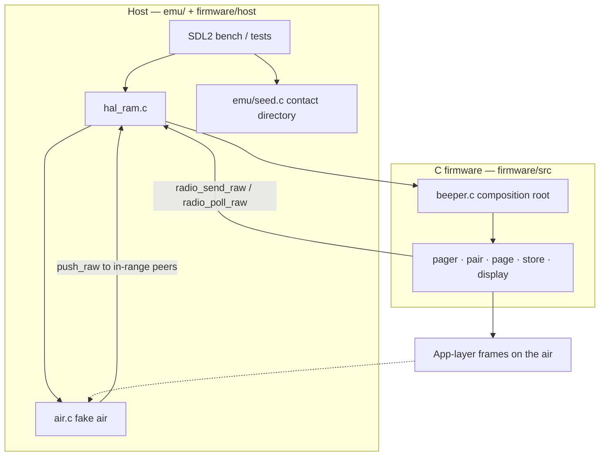

# Architecture

Peeple Beeper firmware is C under `firmware/`. It talks only to a HAL (`firmware/include/hal.h`). A RAM HAL (`hal_ram`) plus `air.c` drive tests and the desktop emulator. `hal/nrf/nrf_hal.c` is a compile-only board stub.

There is no second pager in TypeScript. Host code is an SDL2 window + `hal_ram` + fake air only.

---

## Layer cake

The host never implements pairing or PAGE crypto. Firmware never knows about SDL, NVM files, or where the radios sit. They meet only at the HAL.



Tick order, frame types, and crypto are in [firmware-app.md](firmware-app.md) and [radio-protocol.md](radio-protocol.md).

---

## Directory map

| Path | Role |
|------|------|
| `firmware/include/hal.h` | HAL contract (`hal_t` ops + `ctx`). |
| `firmware/include/beeper.h` | `beeper_init` / `tick` / `reset` / `debug_key`. |
| `firmware/src/*.c` | Pager, pair, page, store, display, crypto, frames. |
| `firmware/host/` | RAM HAL and desktop radio mesh. Tests and the emulator only. |
| `firmware/art/` | Generated 1-bit picture bytes (`art.c`). |
| `firmware/tests/` | `page_test`, `store_test`, `mesh_test`, `locate_test`. |
| `hal/nrf/` | nRF HAL stub; `make nrf-check`. |
| `emu/` | SDL2 window + `seed.c` host directory. |
| `Makefile` | `make test`, `make emu`, `make nrf-check`. |
| `docs/` | This map and protocol/app/HAL notes. |

---

## One beeper, many radios

`beeper_init()` is the composition root of **one** unit. RAM lives on that object, not in module globals.

```text
beeper_t
  identity     node_id + display name
  contacts     session keys for peers
  pager        screens, inbox, outbox, canned, editor
  pair         whisper pairing session
  radio        PAGE TX/RX/relay
  locate       position exchange and the saved fix
  nvm_ready / nvm_hash
```

The emulator wraps each unit with a `ram_hal_t`, a name (`A`, `B`, …), and an east/north foot position. The bench starts with three radios at east 0 / 75 / 150, north 0. **+ add** / **− remove** in the top bar grow the bench up to 16; the window widens to keep every LCD on screen. The compass under each LCD moves that unit; the mesh uses the straight-line distance and relinks immediately. Each device is ticked independently (`beeper_tick`).

---

## Fake air

Radios sit on the east/north foot grid. A hop exists only if the straight-line distance is under 100 ft (`RADIO_RANGE_FT`). RSSI is about −30 dBm at 0 ft and falls ~60 dB across that span; at 100 ft the link is silent (no `push_raw`). There is **no collision model**. Firmware paging does not gate on RSSI; pairing still requires ≥ −45 dBm.

The host also seeds contact books (`emu/seed.c`) so every unit can Compose to every other without walking HELLO. That directory is **not** part of the air protocol.

---

## Persistence

| What | Where |
|------|--------|
| Device NVM | HAL `nvm_load` / `nvm_save`. Emulator files in the per-user app support directory (`emu-nvm-<id>.bin`). Tests: RAM blob. |
| Firmware RAM | Each `beeper_t` | Not persisted except via NVM |

`store.c` is the firmware codec (`PB01` v2). The HAL does not parse the blob.

---

## Run and test

```
make test
make emu
./build/peeple-emu
```

| Before changing | Run |
|-----------------|-----|
| PAGE / ACK / relay / frames / page crypto | `make test` (`page_test`) |
| Locate / GPS grid / RMC | `locate_test` |
| 100 ft mesh + host directory | `mesh_test` |
| NVM encode/decode | `store_test` |

**HAL-only firmware.** Production files under `firmware/src` and `firmware/art` must not assume SDL or files. They call `hal->foo(hal->ctx, ...)`. The RAM HAL and the desktop mesh live in `firmware/host`.

---

## Non-goals

- **No Autofix.** Session keys and contacts are not repaired on the air. The emulator’s preloaded directory is host seeding, not a protocol feature.
- **No shared module-global radio state.** Pairing, PAGE outbox, seen-cache, and inbox live on each `beeper_t`.
- **Art studio** (the old web pixel editor) is not in this tree. Sprite work can return later as a separate tool.

---

## Further reading

- [radio-protocol.md](radio-protocol.md) — HELLO through PAGE_ACK, crypto, relay.
- [hardware.md](hardware.md) — intended pager hardware.
- [hal.md](hal.md) — display buffer, encoder, raw radio, NVM.
- [firmware-app.md](firmware-app.md) — tick, screens, store.
