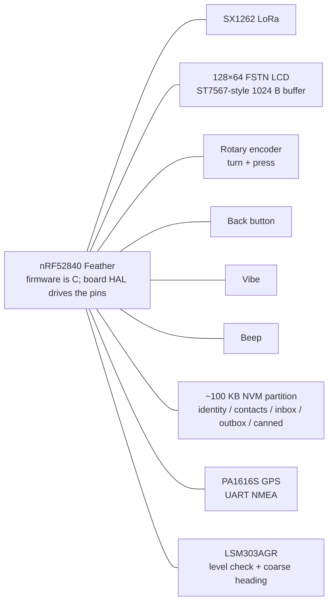

# Hardware

Peeple Beeper is aimed at a pocket pager: an **nRF52840-class MCU**, an **SX1262 LoRa radio**, a **128×64 1-bit FSTN LCD** with an ST7567-style page buffer, a **rotary encoder** plus **back** button, **vibe** and **beep**, a **PA1616S GPS**, an **LSM303AGR** accelerometer and magnetometer, a **battery**, and a **~100 KB persistent store** for identity, contacts, canned favorites, inbox, and outbox. Firmware is C (`firmware/src`) against `hal/hal.h`. The running desktop app is an SDL2 emulator (`emu/`) with the RAM HAL in `hal/emu`. The Feather image is `hal/beeper` (`make beeper`): `beeper_hal.c` is the table, and `board.c` talks to the pins. This document explains why those pieces exist, what they imply for software, and what is real hardware versus emulator-only. It is not a schematic or a BOM.

---

## Device in one paragraph

A beeper is a one-handed, low-bitrate messenger: short canned pages over LoRa, a tiny 1-bit screen, and a contact book that survives power-off. The MCU runs UI, crypto, and the app-layer air protocol; the SX1262 is a clear pipe for ≤128-byte frames, not Wi-Fi or BLE mesh. The LCD’s 1024-byte framebuffer is the HAL display contract. Encoder detents and a back edge drive menus; whisper (minimum TX on a real nRF) plus a **−45 dBm** pairing gate keep Add-contact local. The 100 KB NVM partition is a mailbox budget, not the whole nRF flash. The breadboard runs this firmware. Pairing transmits at −9 dBm. A page transmits at +14 dBm. The desktop bench is still host panes linked by a fake air interface.

---

## Block diagram

Logical connections only. Buses, GPIOs, and regulators are not in the repo.

The contract is [`hal/hal.h`](../hal/hal.h). The emulator implementation is [`hal/emu/emu_hal.c`](../hal/emu/emu_hal.c). The Feather implementation is [`hal/beeper/beeper_hal.c`](../hal/beeper/beeper_hal.c) plus [`hal/beeper/board.c`](../hal/beeper/board.c). See [HAL](hal.md) and [architecture](architecture.md).

---

## Peripherals

Each subsection: role, HAL hook, emulator stand-in, hardware still TBD.

### nRF52840-class MCU

**Role.** Cortex-M4, BLE-capable SoC with enough on-chip flash and RAM for a small UI plus a 100 KB user NVM partition. Firmware is C and `hal/beeper/board.c` is what runs on the Feather. BLE is a property of the silicon, not of this product: paging and pairing go over LoRa. SHA-256, menu drawing, and 128-byte frames are all software; the chip class is chosen because that workload plus a dedicated store partition fits without an application processor.

**HAL hook.** The whole of `hal_t` is what firmware sits on. Time (`now_ms`, `clock`), CSPRNG (`random_fill`), and the other peripherals below.

**Emulator.** The desktop process *is* the MCU for each radio. `now_ms` is milliseconds from boot (`uint32_t` wraps). `clock` is wall HH:MM. `random_fill` is host entropy (LCG in the RAM HAL used by tests).

The Feather image occupies flash `0x26000`–`0xDA000`. The store is the internal flash from `0xDA000` to `0xF4000`, under the UF2 bootloader. Sleep and the nRF 2.4 GHz radio are unused.

### SX1262 LoRa radio

**Role.** Longer-range, low-bitrate pager mesh. Wi-Fi would need infrastructure and more power; BLE’s range and topology are the wrong fit for a neighborhood page flood. The app protocol (pairing, PAGE/ACK, crypto, relay) is independent of PHY: LoRa is a clear pipe. Max raw frame is **128 bytes** (`RAW_FRAME_MAX`). CAD/LBT and collision handling are not implemented.

**HAL hook.** App air uses `radio_send_raw` / `radio_poll_raw` (copy on poll, a zero-length send does nothing). `radio_set_whisper` / `radio_whisper` are TX-power mode (see [Power and pairing](#power-and-pairing)). Pairing and encrypted paging both use that raw path.

**Emulator.** [`firmware/host/mesh.c`](../firmware/host/mesh.c) fans each TX to other host radios. Units sit on the **east/north foot grid**. A hop exists only if the straight-line distance is under 100 ft (`RADIO_RANGE_FT`). RSSI is **−30 dBm** at 0 ft, falling **60 dB** linearly across that span; at 100 ft the link is silent. Firmware paging has **no RSSI gate**; the 100 ft cutoff is host-only. There are **no collisions, no CAD, no airtime model, no loopback**. Whisper is a bool and does not change emulator RSSI or range. Default bench radios sit at east 0 / 75 / 150, north 0, so A reaches C only through B.

On the Feather, **D12** is the SX1262 **NRESET** and nothing else. `board.c` pulses it once at boot, then leaves it high. `radio_set_whisper` and `radio_send_raw` do not pulse it. The module's 32 MHz clock is a TCXO powered from DIO3 at 1.8 V. The modem command list is `hal/beeper/sx1262_setup.c`, shared with the wire test: 915 MHz, SF7, 125 kHz, coding rate 4/5. `radio_send_raw` transmits that frame. Whisper uses −9 dBm. A page uses +14 dBm. `page_radio_reset` only clears RAM. CAD/LBT is not implemented.

### 128×64 1-bit FSTN LCD (ST7567-style)

**Role.** Cheap pager look: eight pages of 128 columns, one bit per pixel. The framebuffer is **1024 bytes** (`DISPLAY_WIDTH * DISPLAY_PAGES`), which is `DISPLAY_BUF_LEN` in the HAL. Firmware draws into that layout; a board HAL can DMA or SPI the same blob to a real ST7567-class controller.

**HAL hook.** `display_clear`, `display_set_pixel`, `display_buffer` (HAL-owned 1024 bytes), `display_flush`. Index is `(y >> 3) * 128 + x`; bit is `1 << (y & 7)`. Firmware (`firmware/src/display.c`) uses the same packing. After drawing, `pager_render` copies into the HAL buffer and calls `display_flush` only if bytes changed.

**Emulator.** The bench blits the buffer to a scaled 128×64 LCD. Pixel colors are a host FSTN approximation (dark on light), not a panel datasheet.

The breadboard glass is the BuyDisplay ERM12864 with an ST7567. `board.c` uses bias `0xA2`, ratio `0x22`, and electronic volume `0x34`. That contrast reads straight on. The backlight switch is a PN2222 on **D13**. The internal pull-up holds the light on. Driving **D13** low turns it off. Settings stores that choice.

### Rotary encoder

**Role.** One-handed menu UI: one detent per row, shaft click for Select, including the on-screen keyboard in `textedit.c`. Firmware never reads quadrature GPIO; it dequeues events.

**HAL hook.** `encoder_poll` returns `ENC_NONE` / `ENC_CW` / `ENC_CCW` / `ENC_PRESS` / `ENC_RELEASE`. Select is the **press** edge. **Release** must not fire a second action. Pair and sending screens skip encoder events so a turn cannot leave those flows.

**Emulator.** Scroll or drag the LCD to turn; click for press+release. Focused pane also maps arrows to turn and Enter/Space to Select. Those mappings are host UX, not hardware.

**Pins.** **D6** and **D9** are the two rotation contacts. **A3** is the shaft switch. All three are active low. The nRF52840 internal pull-up holds each one. The prototype has no external resistor on these pins. `board.c` enables those pull-ups before it samples, and it queues edges so one tick can drain several detents.

**TBD.** Encoder model, pulses per revolution, detent count, and debounce. The HAL is edges/events, not pin levels.

### Back button

**Role.** Escape one screen (and abort pairing on the ADD screen). Separate from the encoder shaft so you can always leave without rotating.

**HAL hook.** `back_poll`: **consumed edge** (latched press), not a GPIO level. One true per press.

**Emulator.** Escape calls `emu_hal_push_back` on the focused radio. The RAM HAL counts pending presses and caps that queue at **8**.

**Pins.** **A4** is active low. The nRF52840 internal pull-up holds it. The prototype has no external resistor on this pin. `board.c` enables that pull-up and reports one falling edge per press.

**TBD.** Debounce.

### Vibe and beep

**Role.** Haptic and audio alerts: new page (`vibe(250)`, `beep(80)`), pairing start/complete, canned save, and a settings vibe tester.

**HAL hook.** `vibe(ms)` and `beep(ms)`. Duration is milliseconds; `vibe(0)` cancels in firmware reset / tester off.

**Emulator.** The RAM HAL stores the last duration in `vibe_ms` and `beep_ms`. The window does not draw a motor or play a tone. No motor, no piezo.

**TBD.** Motor, driver, piezo or speaker, and whether beep is a GPIO toggle or a PWM.

### Battery

**Role.** Status line on the home menu. A percent, and while USB power is present a rough time until the cell is full.

**HAL hook.** `battery` fills a `battery_t`: `pct` from 0 to 100, `charging` while VBUS is present and the cell is below full, and `minutes` until full. `minutes` is 0 when `charging` is false.

**Pins.** The Feather already divides the pack onto **A6** (`P0.29`) with two 100 kΩ resistors, so the pin sees half the cell. No extra wire. The pager reads that pin once a second from its main loop. Full scale at the pin is 3.6 V, then doubled. A ring of 30 readings drops the lowest and highest tenth and averages the rest before the percent lookup. Until the ring is full the percent tracks that average. After that, on the pack the percent only falls. While the VBUS bit is set and the average is at least 3000 mV it only rises, and the minutes until full are recomputed from that percent. Below 3000 mV the reading is not a pack. USB power is the VBUS bit in the power controller. The pack in the assembly guide is 1200 mAh, and the Feather charger is 200 mA, so the time is remaining capacity divided by that rate. The charger holds the cell above its rested voltage, so the percent reads high and the time runs short. The pager's own draw makes the real charge a bit slower still.

**Emulator.** The RAM HAL reports a constant **87** and never charging. No discharge model.

### PA1616S GPS (Adafruit Ultimate GPS breakout)

**Role.** On-demand locate. A paired beeper asks. Open tracking turns the receiver on and, after 7 seconds, replies with a lock from that wait or the last fix it stored, plus the hour and minute of that fix. Ask keeps the receiver on until Allow, then replies the same way. The screen shows distance and bearing, not a map. **EN** stays high until a fix is stored. Driving it low before that resets the search, so the fix LED stays dark and a locate answers with no sky. After a fix, about every **30 minutes** firmware drives **EN** high, listens up to **60 seconds**, and drives **EN** low again. No sky during that later listen keeps the previous fix. The first listen starts at boot. The module’s 10 Hz rate is unused. The default 1 Hz NMEA stream is enough.

**HAL hook.** `gps_power` is the **EN** pin. `gps_fix` returns a fix only while that pin is on, as signed arcminutes times 10,000, the same numbers an RMC sentence posts (`ddmm.mmmm` and `dddmm.mmmm`, N/S and E/W). The locate session does not parse NMEA. `firmware/src/nmea.c` accepts `$GPRMC` / `$GNRMC`. Status `A` is a fix. Status `V` is no sky. The Feather UART is UARTE0 at 9600 on **P0.24**, and each byte goes to `beeper_gps_push_byte`. **D5** follows `gps_power`. A legal time on a status-A RMC sets the wall clock kept beside the fix. The stored fix is in the NVM snapshot (store version 4), along with whether tracking is open or must ask.

**Pins.** Already in [prototype assembly](prototype-assembly.md): GPS **TX** to Feather **RX**, GPS **RX** to Feather **TX**, **EN** to **D5**, **VIN** and **GND** to the 3.3 V rails. **PPS** is unwired. **D5** is the enable so firmware can shut the receiver off; the breakout's pull-up keeps it on until that pin goes low. The CR1220 only keeps the almanac. **SCL** is the compass clock, not the GPS enable.

**Emulator.** Each radio has an integer foot grid `(east, north)`. The first radio starts at `(0, 0)`, which is latitude 0, longitude 0. `(1, 0)` is 1 ft east. `(-150, 150)` is 150 ft west and 150 ft north. Feet become degrees with the WGS84 lengths at the equator (110574.2725 m per degree of latitude, 111319.4908 m per degree of longitude, 1 ft = 0.3048 m), then round to the module’s `0.0001` minute. 1 ft north or east posts as `2`. `(-150, 150)` posts as latitude `248` (`0000.0248 N`) and longitude `-246` (`00000.0246 W`). The same grid is the fake radio range: straight-line distance under 100 ft.

No PMTK command is sent. The module stays at its default 1 Hz stream.

### LSM303AGR heading

**Role.** An 8-way heading while the pager is held roughly level, and a warning when it is not. The budget is about **40°**. The accelerometer is the level check: about **1 g** on the down axis means flat and still. Tip past about **20°** and the screen says `hold flat`. A reading that is not about 1 g, or a running vibration motor, and the screen says `hold still`. Both can show at once. Once the unit stays flat and still, the screen says `do not move` for **400 ms**, then draws the 8-way arrow. The magnetometer supplies north only in that window. There is no gyroscope and no on-chip tilt fusion. The GPS gives position, and a course only when the unit is moving. `hal_t` `heading` returns tilt, stillness, whether the motor is running, and degrees clockwise from north.

**Pins.** [Prototype assembly](prototype-assembly.md): **SDA** and **SCL** to the Feather pins of those names, **VIN** and **GND** to the 3.3 V rails. The compass pin labeled **3Vo** (regulator output beside **VIN**), plus **IA1**, **IA2**, **INTM**, **CSA**, and **CSM**, stay empty. **CSA** and **CSM** left open keep both sensors on I2C. The beep is on **D2**. **D12** is the radio reset only. The prototype part is the Adafruit LSM303AGR breakout. A later board uses the bare **LSM303AGRTR** in its 2×2 mm LGA-12, not this breakout.

**Field.** The vibration motor is a permanent magnet. Sleeping it removes the current, not the magnet. The compass sits at the far end of the breadboard from the motor and the 915 MHz antenna. On this breadboard +X reads about −150 facing north and about −400 facing south, and +Y reads about +60 facing north and about −150 facing south. The heading adds 275 to X and 45 to Y before the angle. Aimed east, that angle sat about 21° south of due east, so 21° is subtracted. Ignore heading while the motor is running.

**Bus.** I2C. The Adafruit breakout answers at `0x19` (accelerometer) and `0x1E` (magnetometer). It is an ordinary I2C slave. The screen, buttons, radio SPI, and GPS UART are not on this bus. There is no compass reset pin. A stuck data line is a power cycle.

**Emulator.** Each radio has **flat** / **tipped** (0° or 25°), **still** / **moving**, a **heading** in degrees (0° is north, **− / +** steps 15°, Shift steps 45°), and **sky** / **no sky**. Flat, still, heading 0°, and sky is the default, so the top of the LCD is north and a locate reply carries the grid fix. The heading label shows the 8-way bucket the arrow uses. **no sky** clears the live fix. **sample** starts a listen on the next tick instead of waiting 30 minutes. A listen with sky stores the grid and the clock; a listen with no sky keeps the previous store. A locate reply sends that store. The locate screen runs the same prompts as the board. The vibe timer counts as the motor running.

`board.c` reads the LSM303AGR on I2C. A custom board must strap the accelerometer address the same way the breakout does (`0x19`) and fit the datasheet capacitor on **C1**.

### 100 KB NVM partition

**Role.** Survive power-off with `node_id` (8 bytes), display name, up to **256** contacts (each with a 16-byte session key), up to **16** saved canned strings, and up to **256** inbox plus **256** outbox rows. That is a mailbox budget: a full inbox/outbox is tens of kilobytes; contacts add more; the snapshot must still fit in **100 KB** (`NVM_BYTES`). Encode drops oldest inbox, then outbox, if a save would overflow. Firmware image, bootloader, and radio calibration stay outside this partition — the HAL does not expose the rest of nRF flash.

**HAL hook.** `nvm_load` copies the blob (returns stored length, or 0 if empty). `nvm_save` replaces it and returns false if `len > NVM_BYTES`.

**Emulator.** The RAM HAL keeps a `uint8_t nvm[NVM_BYTES]` buffer. The app loads and saves `emu-nvm-<id>.bin` in the per-user app support directory. In-flight outbox rows restore as failed (retryable); TX/retry RAM is not in the store.

On the Feather the store is internal flash at `0xDA000` through `0xF4000`. A save erases only the 4 KB pages the new image spans, writes the payload, then the length, then the magic. There is no wear leveling.

---

## Power and pairing proximity

Whisper exists so two people can pair by standing close without advertising a HELLO across the whole pager range.

On **real nRF**, `radio_set_whisper(true)` is **minimum TX power**. Firmware turns whisper on when Add-contact starts and off on commit, abort, timeout, or reset. Incoming pairing frames weaker than **−45 dBm** (`PAIR_RSSI_MIN` in `firmware/include/pair.h`) are ignored. The number is the software gate, tunable. Paging has no RSSI gate: if the PHY (or emulator) delivers the frame, the app accepts it.

On the **emulator**, whisper is only a **bool**. It does not change `air_rssi` or the 100 ft cutoff. Proximity is the straight-line east/north distance plus the firmware −45 dBm check on whatever RSSI the air model attached. At 0 ft RSSI is −30 (pairs); it crosses −45 at 25 ft and pairing frames are dropped after that even though paging still works until 100 ft.

Battery math, sleep current, and TX current vs whisper are not in the repo.

---

## What the board HAL must implement

`hal/beeper/board.c` fills that table on the Feather: glass, knob, Back, RNG, the 100 KB store, RTC milliseconds, the RMC clock, GPS, heading, the battery divider, and the radio. Whisper transmits at −9 dBm, and a page at +14 dBm. Beep and the vibe pin stay idle. **D12** is still reset-only.

Firmware stays the C in `firmware/src`. See [firmware app](firmware-app.md).

---

## Related docs

- [HAL](hal.md) — `hal.h` / `hal_t` contract
- [Radio protocol](radio-protocol.md) — app-layer air (not PHY)
- [Architecture](architecture.md) — firmware vs emulator vs board HAL
- [Firmware app](firmware-app.md) — menus, pairing, paging, store
- [Prototype assembly](prototype-assembly.md) — breadboard pin map
