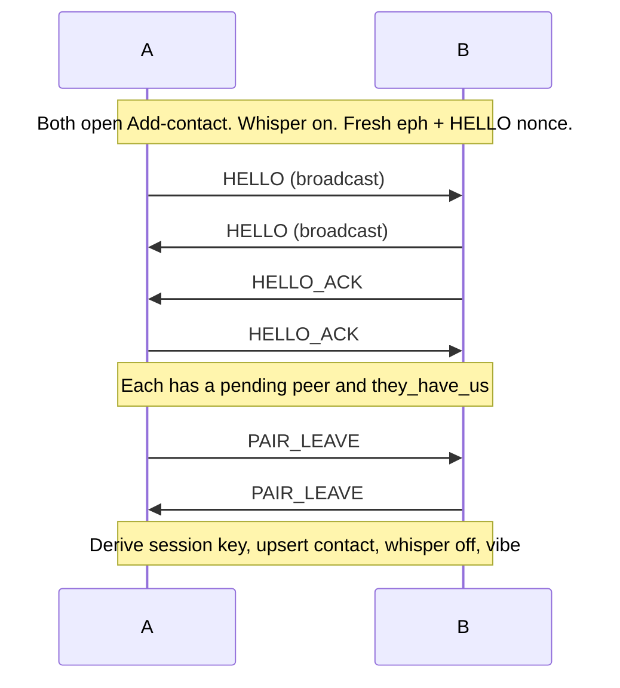

# Radio protocol

Peeple Beeper is a 128×64 FSTN LoRa pager. Firmware is C and runs in a desktop emulator and, later, on the board. Two nearby units can pair, send a short encrypted page, get a receipt, and have neighbors hop that page a couple of hops when the destination is out of direct range.

This file is the app-layer protocol: frame layouts, sizes, crypto, pairing, paging, and mesh relay. Implementation lives in C under `firmware/src` (`frames.c`, `pair.c`, `message.c`, `crypto.c`). Hardware, the HAL, firmware tick/UI, and how the pieces fit together are in [hardware.md](hardware.md), [hal.md](hal.md), [firmware-app.md](firmware-app.md), and [architecture.md](architecture.md).

**Frame version is 1.** The maximum raw air frame is **128 bytes**.

---

## 1. What this protocol does

A **page** is a short UTF-8 message (0–79 characters) from one unit to one contact. The protocol’s job is:

1. **Pair nearby.** Two units in Add-contact exchange HELLO frames, confirm they both heard each other, then leave pairing with a shared **session key**. That key never goes on the air.
2. **Send a short page.** The origin seals the body with the contact’s session key and broadcasts a PAGE.
3. **Get a receipt.** The destination decrypts, shows the text once, and answers with PAGE_ACK. The origin marks the outbox delivered.
4. **Hop through neighbors.** Units that are neither origin nor destination may forward PAGE and PAGE_ACK a limited number of times so a line of beepers can still deliver.
5. **Locate a contact.** The requester asks once. The contact replies with its GPS fix, sealed the same way as a page. Neighbors hop that exchange the same way they hop a page.

If you only remember one picture:

```
pair (whisper, close)     page (normal TX, any in-range hop)
HELLO ─────────────────►  PAGE ──► relay ──► dest
HELLO_ACK ◄─────────────          PAGE_ACK ◄── (relays on the way back)
PAIR_LEAVE ────────────►
```

---

## 2. LoRa versus this protocol

**LoRa** (long range) here means the radio PHY (physical layer): the SX1262 chip moves raw bytes. Firmware treats that path as a **clear pipe**. Anyone in range who is listening can copy every byte.

This document is the **app layer** sitting on that pipe:

| Lives in firmware (`firmware/src`) | Out of scope (not this protocol) |
| --- | --- |
| Frame types, version, sizes | Spreading factor, bandwidth, coding rate |
| Pairing, paging, session keys | CAD / LBT (channel activity / listen-before-talk) |
| XOR seal + truncated MAC | Collision handling, airtime |
| Mesh relay (`hop_ttl`, jitter) | Pinouts, legal/regulatory limits |

The emulator delivers every in-range TX to every in-range RX with **no collisions, no CAD, no loopback**. Firmware paging does not implement those PHY behaviors either. See [hardware.md](hardware.md) for the radio as a device, and [hal.md](hal.md) for `radio_send_raw` / `radio_poll_raw`.

---

## 3. Identities, contacts, session keys

### Node identity

Every unit has an 8-byte **`node_id`**. It is stored in a **100 KB** NVM (non-volatile memory) partition (`NVM_BYTES` in `hal.h`) together with display name, contacts, canned favorites, inbox, and outbox, so it survives power-off. If the store is empty, firmware invents a new id at boot (`identity_load_or_create`).

**Display name** is in the same store. HELLO carries it (max **15** characters, `PAGE_FROM_MAX`). An empty name falls back to the last four hex digits of `node_id`.

### Contact book

The book holds up to **256** peers (`CONTACTS_MAX` in `contacts.h`). Each row is:

- `node_id` (8 bytes)
- name (max 15 chars; empty becomes last four hex of that id)
- **16-byte session key**
- pair time (`paired_ms`)
- Beeple index (one byte). `255` means they have not told us. A later page from them replaces it.

A new id is inserted at the front. Re-pairing the same id overwrites that slot (so a full book can still refresh an existing contact). A **new** id when the book already has 256 rows fails (`contacts_upsert` returns false → pairing error `book full`).

### Session key (not Diffie–Hellman)

Both sides derive the same key from values they already have after exchanging HELLOs. Sort the two `node_id`s as unsigned bytes (lexicographic). Call the smaller one `id_lo` and the larger `id_hi`. Concatenate:

```
id_lo || id_hi || eph_of_lo || eph_of_hi
```

**Session key** = first **16** bytes of SHA-256 of that material. The pairing **ephemeral** (`eph`, 32 random bytes per session) is on the air inside HELLO. The derived key is **never transmitted**. This is not DH and not a hostile-RF design; it is close-range pager crypto so two beepers that completed pairing can seal pages to each other.

### Inbox, outbox, clocks

Inbox and outbox each keep up to **256** rows (`PAGE_KEEP_MAX` in `pager.h`). Each row stores a **local HH:MM** from `hal->clock` at the event (received, sent, ACK’d). Those times are **not on the air**. `255` (`CLOCK_NONE`) means “not yet ACK’d” on an outbox row.

The whole NVM snapshot must fit in 100 KB. If a save would overflow, firmware drops oldest **inbox** rows first, then oldest **outbox**. In-flight outbox rows restore as **failed** (retryable) because TX/retry RAM is not part of the store.

---

## 4. Two radio modes

The radio is in exactly one of two modes. `beeper_tick` runs pairing **or** paging on a tick, never both.

### Whisper pairing

Active while Add-contact is live (`pair_start` → `radio_set_whisper(true)`). Only HELLO / HELLO_ACK / PAIR_LEAVE are processed. PAGE frames that arrive during this window are ignored.

**Whisper** means minimum TX power on hardware. The host emulator only stores a boolean; it does not change range by itself.

Incoming pairing frames weaker than **−45 dBm** (`PAIR_RSSI_MIN`) are ignored. The test is `rssi < -45`, so **−45 dBm is accepted**. Pairing is **not relayed**.

### Paging

The rest of the time. PAGE, PAGE_ACK, LOC_REQ, and LOC are processed. Pairing frames are ignored.

There is **no RSSI gate** on pages in firmware. Range is whatever the PHY (or the host emulator) actually delivers. Inbox rows may *display* the RSSI of the copy that arrived; that value is not used to drop the frame.

Firmware never loops its own TX back (the host mesh has no loopback). A unit also drops a PAGE whose `src` is itself, so it does not relay a page it originated.

---

## 5. Frame catalog

Every frame starts with `type` then `ver = 1`. Unknown types, including `0x00`, are dropped. Decode fails closed on wrong version, wrong length, or oversize fields (`frames.c`).

| Type | Name | Who sends it | Wire size |
|------|------|----------------|-----------|
| `0x01` | HELLO | pairing broadcast | 52–67 |
| `0x02` | HELLO_ACK | pairing unicast | 34 |
| `0x04` | PAIR_LEAVE | pairing unicast | 34 |
| `0x03` | PAGE | origin and relays | 36 + sealed body (max 124) |
| `0x05` | PAGE_ACK | dest and relays | 35 |
| `0x06` | LOC_REQ | requester and relays | 35 |
| `0x07` | LOC | target and relays | 45 |

“Unicast” here means the frame carries a `dest_id`. The PHY still broadcasts; anyone in range can hear it. Pairing firmware simply ignores frames not addressed to it.

### HELLO (`0x01`) — 52–67 bytes

```
offset  size  field
0       1     type = 0x01
1       1     ver = 1
2       8     node_id
10      32    eph          pairing ephemeral (random this session)
42      8     nonce        HELLO nonce (random this session)
50      1     name_len     0..15
51      N     name         UTF-8, N = name_len
51+N    1     beeple       mascot index, or 255 if none
```

Fixed prefix is 51 bytes (`HELLO_FIXED`). Name is clipped to 15 bytes on encode. The Beeple byte follows the name. Pairing stores it on the contact.

### HELLO_ACK (`0x02`) and PAIR_LEAVE (`0x04`) — 34 bytes each

Same layout; the type byte is the only difference.

```
offset  size  field
0       1     type = 0x02 or 0x04
1       1     ver = 1
2       8     src_id
10      8     dest_id
18      16    confirm
```

`confirm` is the first 16 bytes of SHA-256 over the two **raw HELLO frames**, sorted lexicographically as unsigned bytes so both sides compute the same value. ACK means “I have your HELLO.” LEAVE means “I am leaving pairing.” LEAVE is only sent after we have received HELLO_ACK. Receiving LEAVE without a prior HELLO_ACK is a protocol error (`try again`).

### PAGE (`0x03`) — 36 + body, max 124

```
offset  size  field
0       1     type = 0x03
1       1     ver = 1
2       8     dest
10      8     src
18      8     nonce        unique per TX attempt
26      1     hop_ttl      origin TX = 3; relays rewrite in place
27      1     body_len     0..87
28      N     body         sealed ciphertext, N = body_len
28+N    8     mac
```

Clear header (`dest`, `src`, `nonce`, `hop_ttl`) is plaintext so relays can forward without the session key.

**`hop_ttl` is not in the body MAC.** Relays decrement it with `frame_set_hop_ttl` and leave cipher + MAC untouched.

Body plaintext before seal is `msg_id[8] || beeple || UTF-8 text`. `beeple` is one byte, the sender's mascot index at `page_tx` (retries keep that byte). Text is 0–79 bytes (`PAGE_BODY_MAX`). Wire body is therefore up to **88** bytes of ciphertext (`8 + 1 + 79`). Header+MAC is 36, so max PAGE is **124**, under the 128-byte raw cap. Relays still cannot read the index.

### PAGE_ACK (`0x05`) — 35 bytes

```
offset  size  field
0       1     type = 0x05
1       1     ver = 1
2       8     dest         = original PAGE src (origin)
10      8     src          = original PAGE dest (intended recipient)
18      8     nonce        = that PAGE copy’s nonce
26      1     hop_ttl      dest TX = 3; relays rewrite in place
27      8     mac
```

Addresses are **swapped** relative to the PAGE. Relays forward ACK the same way they forward PAGE. They **do not** verify the MAC.

### Crypto on PAGE / PAGE_ACK

Hash is SHA-256. Truncations are prefixes.

**PAGE seal.** Cipher = plaintext XOR keystream. Keystream is SHA-256(`session_key || nonce`) (32 bytes), repeated with `i & 31` as needed. MAC = first 8 bytes of SHA-256(`session_key || nonce || cipher`). Open fails closed on MAC mismatch (`page_open`).

**PAGE_ACK MAC.** First 8 bytes of SHA-256(`session_key || nonce || "ACK"`) where `"ACK"` is the three ASCII bytes `41 43 4b`. Only the origin (who has the dest’s session key) verifies it. A well-formed ACK with a garbage MAC still **cancels pending PAGE relays** (relays have no key). The origin will not mark delivered unless the MAC checks.

**LOC_REQ MAC.** First 8 bytes of SHA-256(`session_key || nonce || "REQ"`) where `"REQ"` is the three ASCII bytes `52 45 51`. Same role as the ACK MAC: only the two paired units can check it. Relays do not.

**LOC seal.** Same XOR keystream and 8-byte MAC as PAGE, over a fixed 11-byte plaintext.

---

## 6. Pairing walkthrough

Window: **20 s** (`PAIR_WINDOW_MS`). While the window is open, HELLO and, once applicable, HELLO_ACK and PAIR_LEAVE rebroadcast about every **400 ms** (`HELLO_PERIOD_MS`).



1. Both units enter Add-contact. Whisper on. Fresh 32-byte `eph` and 8-byte HELLO nonce. Start broadcasting HELLO (plus vibe 80 ms on start).
2. Hear a foreign HELLO at **≥ −45 dBm** → remember that peer (one pending HELLO; a different sender, or the same sender with a new ephemeral, replaces it and clears `they_have_us`; the same ephemeral keeps the flag) and send HELLO_ACK.
3. Hear HELLO_ACK whose `dest` is us, `src` is the pending peer, and `confirm` matches → they have our HELLO (`they_have_us`).
4. Once we have a pending peer **and** they have us, each 400 ms burst is HELLO + HELLO_ACK + PAIR_LEAVE.
5. Hear a matching PAIR_LEAVE → send LEAVE, **commit** (derive session key, `contacts_upsert`), whisper off, vibe 200 ms, done.

Abort without committing on **timeout**, **book full** (256 distinct contacts; existing contact refresh still succeeds), or **LEAVE before ACK** (`try again`). Back on the pair screen also aborts (`pair_abort`).

Pairing is not mixed with paging on the same tick: if a pair session is active, only `pair_tick` polls raw RX.

---

## 7. Paging: send, decrypt, ACK, retry

A composed message becomes one radio **outbox**: dest id, a sealed **`msg_id`** (8 random bytes, stable for this send), UTF-8 body, and the list of **nonces actually transmitted**. The UI outbox row is separate (local clocks, status). Only one radio send is in flight at a time (`page_busy`).

### Origin TX

`page_tx` looks up the dest in the contact book (unknown dest → no send). It generates `msg_id`, seals `msg_id || beeple || text`, and transmits PAGE with `hop_ttl = 3` (`PAGE_HOP_TTL`: origin plus up to two relay hops).

**TX schedule (9 attempts):** t = 0, 10 s, 20 s, 30 s, then every 60 s at 90 / 150 / 210 / 270 / 330 s. After the last TX the origin waits another 60 s for ACK, then the outbox is **failed**. There is no 10th TX. Constants in `attempt.h`: `ATTEMPT_PAGE_FAST = 4`, `ATTEMPT_PAGE_SLOW = 5`, `ATTEMPT_PAGE_FAST_MS = 10_000`, `ATTEMPT_PAGE_SLOW_MS = 60_000`.

**Each attempt uses a new random nonce.** Same `msg_id` and text. Relays key on `(frame type, src, nonce)`, so a retry is a new flood, not a duplicate of the previous copy.

The UI can re-queue a failed send. That calls `page_tx` again, which draws a **new `msg_id`** and new nonces.

### Destination

1. Look up PAGE `src` in the contact book. Unknown src → drop, **no ACK**.
2. Open the body with that session key. MAC fail, or plaintext shorter than 9 bytes (`msg_id` plus the Beeple byte), → drop, no ACK. A known Beeple index updates that contact. An unknown index leaves the stored one alone, and the New beep screen keeps the spider.
3. Inbox **once** per `(src, msg_id)` (radio `delivered` list, last **24** pairs). The UI inbox then keeps up to 256 rows. A late copy after that 24-entry cache has rolled off could theoretically call `pager_on_page` again.
4. **ACK every copy** (every nonce), including repeats, so a late relay still produces a receipt. ACK `hop_ttl` is also **3** (fresh, not copied from the PAGE).

### Origin receipt

An ACK counts if `dest` is us, `src` is the outbox dest, `nonce` is any nonce from this send, and the ACK MAC checks. Then the outbox is **delivered**. An ACK for an unknown nonce is ignored. MAC failure does not deliver.

---

## 8. Relay / mesh

Anyone who is **not** dest and **not** origin may forward a PAGE or PAGE_ACK if `hop_ttl > 1`. The forwarded copy has `hop_ttl − 1`. `ttl ≤ 1` is not queued.

**Seen cache:** 24 recent entries (`SEEN_MAX`), keyed by `(kind, src, nonce)`.

- PAGE is keyed by origin `src` + nonce.
- PAGE_ACK is keyed by ACK `src` (the page dest) + nonce.

After this node has already transmitted that nonce, a later hear does not TX again.

### Jitter, re-roll, cancel

**Jitter:** first time a copy is eligible, wait a random **80–400 ms** inclusive (`RELAY_JITTER_MIN_MS` / `RELAY_JITTER_MAX_MS`), then TX once. After TX, `pending` is cleared; that nonce is not armed again.

**Duplicate PAGE or ACK while still waiting:** do **not** cancel. **Re-roll** the jitter (new 80–400 ms from now). Keep the already-prepared copy (do not decrement ttl again). A nearby relay TX must not silence a unit that can still reach someone the first relay cannot.

**Cancel pending PAGE only on PAGE_ACK** for that origin+nonce (ACK `dest` = PAGE `src`, same nonce). That is proof the dest decrypted *some* copy. If ACK is heard **before** PAGE, never schedule that PAGE relay.

**Do not cancel a pending ACK relay** because another ACK was heard. Same topology problem on the return path: the unit that can still reach the origin must still forward. Duplicate ACK → re-roll, still send once.

Relays never decrypt PAGE bodies. They never verify ACK MAC. Each node sends a given nonce at most once (PAGE) and at most once (ACK). Dense meshes serialize extra copies instead of suppressing them; origin retries still bound the conversation.

### Why re-roll (A–B–C–D)

```
A ---- B ---- C ---- D
     ~99 ft each hop
```

A cannot hear C or D. B cannot hear D. Origin `hop_ttl = 3` so the PAGE can be A → B (`ttl` 2) → C (`ttl` 1) → D (stop).

Now the failure mode jitter-cancel would cause:

```
     A
    / \
   B   C ---- D
```

B and C both hear A’s PAGE and arm jitter. B transmits first. C hears B’s copy. If C **cancelled**, D never gets the PAGE. So C **re-rolls** and still forwards once.

Cancel PAGE relay only when a PAGE_ACK for that origin+nonce is heard: dest already has the plaintext, further PAGE hops are wasted. Do **not** apply that cancel to ACK relays. If C cancelled its ACK because it heard B’s ACK, and B cannot reach A, A never gets a receipt.

`firmware/tests/relay_test.c` encodes these rules: ttl decrement once, ttl=1 dropped, second hear before TX re-rolls still one TX, PAGE_ACK cancels pending PAGE, ACK-first then PAGE does not schedule PAGE, duplicate ACK still relays once, a new nonce is a new flood. Mesh range is `firmware/tests/mesh_test.c`.

LOC_REQ relays like PAGE. LOC relays like PAGE_ACK. A heard LOC cancels a pending LOC_REQ for that requester and nonce. A duplicate LOC re-rolls and still forwards once. A LOC heard before the request does not schedule that request.

---

## Locate

Menu → **Locate** → one paired contact. The requester sends LOC_REQ. The contact reads `gps_fix` and answers with one LOC. The screen draws an 8-way arrow from the two fixes and the device heading, plus the distance. The arrow appears only after the unit is held flat and still. The coordinates travel on the air and are not drawn.

### LOC_REQ (`0x06`) — 35 bytes

Same layout as PAGE_ACK. `dest` is the contact. `src` is the requester. `hop_ttl` starts at 3. MAC is the REQ MAC above.

### LOC (`0x07`) — 47 bytes

Same header as PAGE, with `body_len` fixed at 11. `dest` is the requester. `src` is the contact. `nonce` echoes the request. `hop_ttl` starts at 3.

Plaintext before seal:

```
offset  size  field
0       1     flags     bit0 = fix valid (LOC_FLAG_FIX); bit1 = refused (LOC_FLAG_DENY)
1       4     lat       little-endian int32, arcminutes × 10000, +north
5       4     lon       little-endian int32, arcminutes × 10000, +east
9       1     hour      wall-clock hour of the stored fix, 0–23
10      1     minute    wall-clock minute of the stored fix, 0–59
```

Those integers are the PA1616S RMC fields, not decimal degrees and not feet. Latitude posts as `ddmm.mmmm` plus `N`/`S`. Longitude posts as `dddmm.mmmm` plus `E`/`W`. Degrees are `value / 100` of that field; the remainder is minutes. Store signed arcminutes times 10,000. `4807.0380,N` is 48 degrees + 7.0380 minutes = `28870380`. `S` or `W` flips the sign.

The contact turns the receiver on when the request arrives. Open tracking waits 7 seconds, then sends a lock taken in that window, or the last stored fix if none arrived. Ask waits until Allow, and the receiver stays on until then; Allow sends the same way. The hour and minute are from that fix. The requester shows that clock under the distance (`Last Loc : HH:MM`). A contact that has never stored a fix still replies (`flags = 0`, coordinates 0, time 0). An unknown contact is dropped with no reply. A bad REQ MAC is dropped with no reply.

**Consent.** Each unit stores whether permissionless tracking is allowed (Settings → Tracking, `open` or `ask`). A fresh device, a factory reset, and a snapshot from before this flag all ask.

When tracking is open, a valid LOC_REQ starts the receiver. The target shows that contact `is locating you` after 5 seconds. The coordinates go out after 7 seconds. Another request from the same contact within 12 seconds of the warning does not show it again.

When tracking asks, the target sends nothing until the user picks Allow or Deny. A retry while that prompt is up replaces the nonce, so Allow still matches the request the requester is waiting on. Allow sends the stored fix. For the next 30 minutes (`TRACK_ALLOW_MS`) a request from that same contact is answered at once, with no new prompt and no "is locating you" warning. That grant is kept in RAM: a reboot, a factory reset, or the end of the 30 minutes asks again. Deny does not start the timer. Deny sends `LOC_FLAG_DENY` with coordinates 0. The requester stops and shows `denied`, including when it already had an older fix. Back on the prompt denies.

**Retries.** 4 attempts, 2 seconds apart (`ATTEMPT_LOCATE_BUDGET`, `ATTEMPT_LOCATE_MS` in `attempt.h`). After the fourth transmit the requester waits 7 seconds (`ATTEMPT_LOCATE_MS` plus `ATTEMPT_LOCATE_TAIL_MS`), then the screen says **no reply**. That covers the 5 second alert and the 7 second open reply. A later request, sent when the unit returns to flat and still, uses the same retries. If that one fails, or the contact answers with no sky, the previous target fix and its `Last Loc` time stay. A page and a locate may both be armed. On each tick a locate attempt, or a locate reply, goes out ahead of a page.

**Distance.** The screen converts the posted arcminutes back to whole feet with the same WGS84 lengths used to build a fix (110574.2725 m per degree of latitude and 111319.4908 m per degree of longitude at the equator, 1 ft = 0.3048 m). One `0.0001` minute is about 0.6 ft, so a 1 ft step posts as 2 quanta and the screen rounds back to 1 ft. Under 1000 ft the line is `75 ft`. At or above 1000 ft it is miles to one decimal. The arrow snaps that offset to eight directions and rotates it by the unit’s heading, so the tip points toward the contact relative to the top of the device.

---

## 9. Host emulator range versus firmware

The host (`firmware/host/mesh.c`) places units on the **east/north foot grid**. A hop exists only if the straight-line distance is under 100 ft (`RADIO_RANGE_FT`). At **100 ft** the link is silent (no RX).

RSSI is about **−30 dBm** at 0 ft, falling **60 dB** linearly across that span. Pairing still requires **≥ −45 dBm** on top of being in range, so two units can be in paging range on the emulator and still fail to pair.

Firmware paging **does not look at RSSI**. Adding or removing radios rewires the mesh and may seed contact books; that is host directory logic, not air protocol. See [architecture.md](architecture.md).

---

## 10. Dispatch and HAL

Tick order (`beeper.c`):

1. If pairing is active → only `pair_tick` polls raw RX.
2. Else `beeper_sessions_tick`: drain raw RX (PAGE and PAGE_ACK to the message session, LOC_REQ and LOC to locate), then a page retry unless locate is sending, then due relays, then the locate retry and locate relays.

HAL used by this protocol ([hal.md](hal.md)):

- `radio_send_raw` / `radio_poll_raw` — app-layer frames.
- `radio_set_whisper` — pairing TX power (emulator: a flag).
- `random_fill` — `node_id`, eph, nonces, `msg_id`.
- `nvm_load` / `nvm_save` — 100 KB store.
- `now_ms` — retry and jitter clocks (`uint32_t` wrap).
- `clock` — local HH:MM for inbox/outbox only.
- `gps_fix` — latest fix as `lat_min_e4` / `lon_min_e4`, or no fix.

---

## Intentionally not implemented yet

- LoRa CAD / LBT / airtime / spreading factor, and collision handling (the emulator has none).
- Encrypted dest/src (relays need them in the clear).
- Authenticated ACK at relays (relays cancel pending PAGE on any well-formed ACK for that origin+nonce).
- Live `hop_ttl` config (compiled as 3; retries use unique nonces instead of re-arming at ttl==3).
- Multi-peer pairing in one window (one pending HELLO at a time).
- Firmware range gate on pages (emulator 100 ft only).
